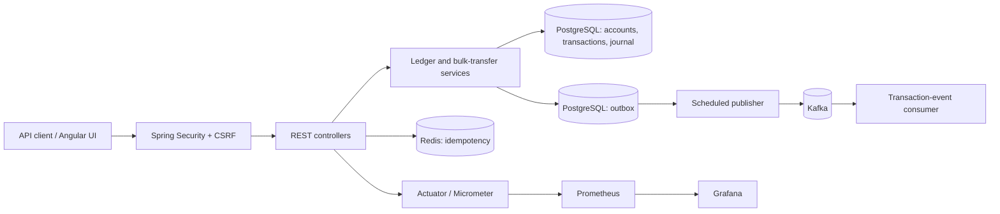

# FiscalMotion

**A Java 21 / Spring Boot 4.1.2 financial ledger backend demonstrating double-entry accounting, concurrent transfers, bulk processing, and asynchronous event delivery.**

FiscalMotion is an engineering portfolio project, **not a production-certified banking system**. It emphasizes transaction correctness, failure isolation, observability, and testable architectural trade-offs.

## Features

- **Double-entry journal:** debit and credit entries per completed financial transfer, with write-time validation and reconciliation checks.
- **Account management:** account creation with opening balance funded by an internal clearing account; balance adjustments with audit history.
- **Transfers:** PostgreSQL transactions, deterministic account lock ordering, balance checks, unique transaction references, and Redis-based idempotency-key coordination.
- **Bulk transfers:** persisted batches and row states, per-row reference IDs, and reconciliation support for uncertain outcomes.
- **Authentication:** session-based authentication, CSRF protection, and OWNER / USER roles.
- **Event delivery:** transactional outbox persisted with financial transactions; scheduled Kafka publisher; Kafka transaction-event consumer.
- **Resilience and monitoring:** Resilience4j rate limiting/circuit-breaker configuration, Spring Actuator, Micrometer, Prometheus, Grafana, and k6.

## Architecture



**Consistency boundary:** account balance changes, journal entries, and outbox creation belong to the PostgreSQL transaction. Kafka delivery happens later. This avoids treating Kafka availability as a prerequisite for committing a transfer, but it is **at-least-once delivery**, not a cross-system exactly-once guarantee.

## Technology

| Layer | Technology |
| --- | --- |
| Backend | Java 21, Spring Boot 4.1.2, Spring Security, Spring Data JPA |
| Database | PostgreSQL 16 (Docker Compose), Hibernate |
| Idempotency / cache | Redis 7 |
| Messaging | Apache Kafka 3.8 (single-node local development) |
| Observability | Micrometer, Actuator, Prometheus, Grafana |
| Resilience | Resilience4j |
| Tests | JUnit, Spring Boot Test, Testcontainers |
| Performance | k6 |
| Local infrastructure | Docker Compose |

## Run locally

### Prerequisites

Java 21, Docker Desktop with Compose, Maven (or Maven Wrapper), and optionally k6. The application runs on the host; infrastructure services run in Docker.

1. Clone the repository and configure environment variables. Keep real passwords in an untracked `.env` or your environment; **never commit credentials**.
2. Start infrastructure:

   ```bash
   docker compose up -d
   ```

3. Start the backend:

   ```bash
   ./mvnw spring-boot:run
   ```

   On Windows PowerShell use `./mvnw.cmd spring-boot:run`.

4. Useful local addresses:

   | Service | Address |
      | --- | --- |
   | Backend | `http://localhost:8080` |
   | PostgreSQL | `localhost:5434` (default host port) |
   | Redis | `localhost:6379` |
   | Kafka | `localhost:9092` |
   | Prometheus | `http://localhost:9090` |
   | Grafana | `http://localhost:3000` |

5. Set up an OWNER account using the project's controlled bootstrap configuration (`FM_OWNER_BOOTSTRAP`, `FM_OWNER_EMAIL`, `FM_OWNER_PASSWORD`) for first-time local use, then disable bootstrap. Use a unique password of at least 12 characters. Authenticate through `/api/v1/auth/csrf` and `/api/v1/auth/login`; protected write requests require the session cookie and CSRF header.

> The checked-in Compose configuration is intended for **local development**. It uses a single Kafka broker, development-friendly service exposure, and a default Grafana password unless overridden. Do not deploy it unchanged to the public internet.

## Key endpoints

| Method | Endpoint | Purpose |
| --- | --- | --- |
| GET | `/api/v1/auth/csrf` | Obtain CSRF token |
| POST | `/api/v1/auth/login` | Establish authenticated session |
| GET | `/api/v1/auth/me` | Current authenticated user |
| POST | `/api/v1/accounts` | Create account |
| GET | `/api/v1/accounts/{id}` | Account details |
| POST | `/api/v1/accounts/{id}/adjustments` | Balance adjustment |
| POST | `/api/v1/ledger/transfers` | Transfer; requires `Idempotency-Key` header |
| POST | `/api/v1/ledger/transfers/bulk` | Submit bulk transfer; requires `Batch-Id` header |
| GET | `/api/v1/ledger/transfers/bulk/{batchId}` | Bulk batch status |
| GET | `/actuator/health` | Health endpoint |

All financial endpoints require appropriate authentication and authorization. Use the actual request DTOs in `src/main/java/com/fiscalmotion/ledger/dto` for payload schemas.

## Correctness and failure testing

Integration tests cover transfer rollback, concurrent transfers, insufficient funds/overdraft prevention, journal validation, reconciliation, and bulk-processing scenarios. Run:

```bash
./mvnw clean verify
```

On Windows: `./mvnw.cmd clean verify`. Testcontainers integration tests require a working Docker daemon. Report **BUILD SUCCESS** only after running the suite on the final commit.

### Kafka outage and recovery smoke test

1. Identify the broker with `docker ps`; the current Compose container is `fiscalmotion_kafka`.
2. Stop only Kafka: `docker stop fiscalmotion_kafka`.
3. Perform one authenticated transfer. Confirm the PostgreSQL financial transaction commits and its outbox event is pending.
4. Restart Kafka: `docker start fiscalmotion_kafka`.
5. Confirm the outbox event is eventually marked processed and that the financial transfer was not repeated.

Inspect pending events using the actual outbox table/column mappings. A successful smoke test demonstrates recovery in the tested configuration, **not universal exactly-once delivery**.

## Performance benchmarking (authenticated k6 transfers)

Two local benchmarks were executed against the authenticated `POST /api/v1/ledger/transfers` endpoint. Each transfer used a fresh `Idempotency-Key`, an authenticated Spring Security session, and a CSRF token. **Latency values below include successful HTTP 201 transfers only**; HTTP 429 throttling is counted separately.

| Metric | Baseline (1 VU, 60 s) | Concurrent load (up to 50 VUs, ~50 s) |
| --- | ---: | ---: |
| Average successful transfer latency | 38.60 ms | 85.79 ms |
| p50 | 33.10 ms | 77.10 ms |
| p90 | 50.06 ms | 156.43 ms |
| **p95** | **57.79 ms** | **171.02 ms** |
| **p99** | **67.11 ms** | **189.00 ms** |
| Maximum | 591.62 ms | 223.93 ms |
| Successful transfers (201) | 136 | 498 |
| Accepted transfer rate | 2.26/s | 9.94/s |
| Throttled transfer requests (429) | 0 | 7,701 |
| Unexpected transfer responses | 0 | 0 |

**Thresholds met in both runs:** p95 < 300 ms, p99 < 500 ms, unexpected transfer response rate < 1%.

### Load profile and interpretation

- **Baseline:** one virtual user for 60 seconds, with 400 ms think time.
- **Concurrent load:** 0 → 20 VUs (10 s), 20 → 50 VUs (30 s), 50 → 0 VUs (10 s), with 100 ms think time.
- **Contention:** all virtual users transferred between the same account pair; this exercises account-row locking and does not measure independent-account capacity.
- **Rate limiting:** the application is configured for 10 transfer requests per second. The 50-VU run attempted 8,199 transfers; 498 succeeded and 7,701 were intentionally rejected with HTTP 429. The generic k6 `http_req_failed` rate includes these expected 429 responses, so it must not be interpreted as 92% unexpected application errors.
- **Scope:** results are from a local development environment, not a production capacity or availability claim. The observed ~9.94 successful transfers/second is limited by the configured rate limiter; it is not the maximum unrestricted ledger throughput.
- **Integrity follow-up:** across both runs, 634 transfers succeeded. At the configured ₹1 test amount, the expected net movement is ₹634 from the source to the destination account. Confirm against database balances and double-entry journal before claiming post-benchmark reconciliation.

### Reproduce the authenticated test

Use the **updated authenticated k6 script** with `noCookiesReset: true` so each virtual user retains its Spring Security session between iterations. The original `load_test.js` in the inspected ZIP was unauthenticated; replace it with the authenticated script used for these measurements before publishing the repository.

Run against **dedicated test accounts only** because transfers modify persisted balances:

```powershell
$env:FM_BASE_URL="http://localhost:8080"
$env:FM_EMAIL="<test-user-email>"
$env:FM_PASSWORD="<test-user-password>"
$env:FM_SOURCE_ID="<source-account-uuid>"
$env:FM_TARGET_ID="<target-account-uuid>"
$env:FM_AMOUNT="1.0000"

$env:MODE="baseline"
k6 run --summary-export baseline.json .\load_test.js

$env:MODE="load"
k6 run --summary-export concurrency.json .\load_test.js
```

The authenticated script should count successful transfers (`201`), rate-limited requests (`429`), and unexpected responses separately. Preserve benchmark summaries outside version control if they contain environment-specific details.

## Monitoring

- Prometheus configuration: `prometheus.yml` scrapes `host.docker.internal:8080/actuator/prometheus` every five seconds.
- Grafana: connect Prometheus at `http://prometheus:9090` from the Grafana container network, then graph request duration, throughput, error rate, and custom transaction metrics.
- Note: Spring Security currently denies non-whitelisted actuator paths; configure **restricted, authenticated** Prometheus access before claiming that scraping is operational. Do not expose metrics publicly without access control.

## Known limitations and design trade-offs

1. **Kafka is at-least-once:** a crash after Kafka acknowledgment but before PostgreSQL records the outbox acknowledgment may republish an event. Financially consequential consumers require durable deduplication.
2. **Consumer scope:** the inspected `SettlementConsumer` parses/logs transaction events; it does not implement a complete settlement accounting pipeline. Do not describe it as a completed settlement engine.
3. **Publisher deployment:** the current outbox polling approach is intended for one publisher instance. Multiple replicas require safe row claiming/locking.
4. **Bulk recovery:** a row interrupted in `PROCESSING` or `UNKNOWN` requires reconciliation against transaction reference and journal before controlled retry. Blind replay risks duplicate processing.
5. **Idempotency:** Redis coordinates request keys, while PostgreSQL's unique reference constraint is the durable last line of defense. This is not a universal exactly-once API guarantee.
6. **Schema management:** development uses Hibernate `ddl-auto: update`; schema migration/versioning is deferred and would be necessary before a serious production rollout.
7. **Local security:** development credentials, plaintext local Kafka traffic, and container defaults must be replaced before external deployment.

## Repository map

```text
fiscalmotion/
├── src/main/java/com/fiscalmotion/ledger/
│   ├── auth/                 # Session authentication and user lifecycle
│   ├── config/               # Security and Redis configuration
│   ├── controller/           # Account, transfer, bulk-transfer APIs
│   ├── dto/                  # Request and response types
│   ├── model/                # Accounts, transactions, journal, outbox
│   ├── repository/           # Spring Data repositories
│   ├── service/              # Ledger, bulk, reconciliation, publisher
│   └── validation/           # Money and journal validators
├── src/test/                 # Unit and integration tests
├── docker-compose.yaml      # PostgreSQL, Redis, Kafka, Prometheus, Grafana
├── prometheus.yml
├── load_test.js              # Replace original with tested authenticated k6 script
└── pom.xml
```

## Project status

The core financial backend and local infrastructure are implemented, and the authenticated baseline and 50-VU benchmarks have been completed with the results above. Before publishing, verify `mvn clean verify` on the **latest local source**, reconcile the post-benchmark financial balances and journal, confirm any outbox/consumer fixes made after the inspected ZIP, replace the original unauthenticated k6 script, and remove secrets from Git history. This README distinguishes observed results from production-ready guarantees.
